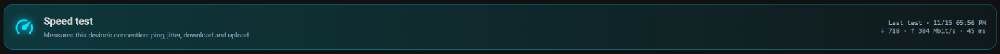
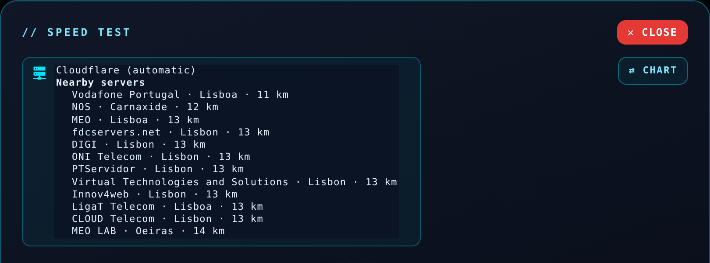

# Speedtest Popup Card

A Home Assistant dashboard card that runs an internet speed test in a popup: ping, jitter, download and upload, with a live gauge. The test runs in the browser of the device you are looking at the dashboard on, so it measures that device's connection, not the Home Assistant server's.

[Versão em português](README.pt-PT.md)


The card itself is a single button. It shows the last result on the right:



## What it does

- Opens a popup on top of the dashboard and runs the test when you press **Start test**. A test takes about 25 seconds.
- Measures ping and jitter first, then download, then upload. The gauge follows the speed in real time, and you can set the top of its scale with `max`.
- Can store the result in Home Assistant helpers, so you can chart it, use it in automations or show it on other cards. This is optional.
- Without helpers, it remembers the last result in the browser.
- Optional chart: with `chart: true`, a button in the popup swaps the gauge for the download and upload curves, second by second.
- English and Portuguese. It follows the language of your Home Assistant profile.
- Server choice: Cloudflare by default, or one of the nearest Speedtest servers run by internet providers, picked from a list in the popup.
- No other cards or integrations are needed.

## What's new in 1.2.0

- **Choose the test server.** A list at the top of the popup offers Cloudflare (the default) and the nearest Speedtest servers run by internet providers, with their city and distance. The card fetches the list on its own, so it works in any country without installing anything. Each browser remembers its choice.
- **Tidier popup.** The **Chart** button moved from the title bar to the row under it, next to the server list, and the chart now takes the same space as the gauge, so the popup no longer changes size when you switch.

Nothing changes for existing cards: the test still runs against Cloudflare unless you pick another server. The full history is in [CHANGELOG.md](CHANGELOG.md).

## Choosing the test server



- **Cloudflare (automatic)** is the default. Cloudflare picks its nearest data centre for you, and the footer shows which one was used.
- **Nearby servers** are the public Speedtest servers closest to the device's internet connection, with the provider, the city and the distance in km. The list changes with where you are: at home in Lisbon it shows providers such as Vodafone, NOS and MEO; elsewhere it shows the ones near you.
- The choice is kept in the browser, so each device can use a different server.
- A provider's server is usually closer than Cloudflare, so the ping is lower and the result is closer to what your provider sells you. Testing against more than one server helps you tell a slow line from a slow route.
- If a server does not answer, the test stops with a message and you can pick another one or go back to Cloudflare. If the list cannot be loaded, only Cloudflare is offered.
- Add `server_list: false` to hide the list and always use Cloudflare.

## The chart panel

Add `chart: true` to the card and a **Chart** button appears in the popup, on the row under the title:


- The button swaps the gauge for the chart and back. You can press it before, during or after a test.
- The blue line is the download speed and the yellow line is the upload speed, both in Mbit/s.
- The horizontal axis is the time since the start of each phase, in seconds. Both lines start at zero, so you can compare how fast each one ramps up and how steady it stays.
- The vertical scale adjusts itself to the highest speed measured, so it needs no configuration on slow or very fast lines.
- The lines are drawn live while the test runs and stay on screen when it ends, until you run another test or reload the page.
- The popup always opens on the gauge, and it keeps the same size when you switch.

A dip in the middle of a line usually means the connection was shared with something else at that moment, or that the Wi-Fi signal dropped. A line that climbs slowly and never flattens suggests the test is too short for that connection: try a higher `duration`.

## How the measurement works

The test runs directly from your browser, against the server chosen in the list.

With **Cloudflare** the card uses its public speed test endpoints (`speed.cloudflare.com`):

| Value | How it is measured |
| --- | --- |
| Ping | The fastest of 16 small requests |
| Jitter | The median difference between consecutive requests |
| Download | 8 parallel connections fetching 5 to 50 MB blocks for 10 seconds |
| Upload | 6 parallel connections sending 1 to 32 MB blocks for 10 seconds |

With a **provider's Speedtest server** the card gets the list of nearby servers from `www.speedtest.net` and then talks to the chosen server over a secure WebSocket connection:

| Value | How it is measured |
| --- | --- |
| Ping | The fastest of 16 ping messages |
| Jitter | The median difference between consecutive pings |
| Download | 6 parallel connections receiving 1 to 25 MB blocks for 10 seconds |
| Upload | 6 parallel connections sending 1 to 8 MB blocks for 10 seconds |

Things to know before you rely on the numbers:

- **It measures the device in front of you.** On a wired PC you get the line speed. On a phone you get that phone's Wi-Fi. This is different from the built-in Speedtest.net integration, which runs on the Home Assistant server.
- **Ping is higher than a classic ping.** It is measured with web requests, which add some overhead.
- **A browser test usually reads a little below a native app** on very fast lines.
- **The device needs internet access** and must be able to reach `speed.cloudflare.com`, plus `www.speedtest.net` and the chosen server if you use the server list.
- **Cloudflare can limit or change these endpoints.** They are public, but they are not a guaranteed service for third parties. If requests are refused, the card falls back to smaller blocks; if everything is refused, it shows "Test failed" and stores nothing. Running many tests in a row can trigger these limits.
- **The Speedtest servers belong to the internet providers.** A provider can stop accepting tests from web pages at any time. If that happens, pick another server or Cloudflare.
- **Each test uses data:** roughly 1 GB down and 500 MB up on a 1 Gbit/s line with the default duration. Lower `duration` on metered connections.

## Installation

### Home Assistant Marketplace (HACS)

[](https://my.home-assistant.io/redirect/marketplace_repository/?owner=miltonleopoldo&repository=speedtest-popup-card&category=plugin)

Or add it by hand:

1. Go to **Settings → Marketplace** (on older versions, open **HACS**).
2. Choose **Add from link** (in HACS: **⋮ → Custom repositories**, type **Dashboard**).
3. Paste the address of this repository and press **Install**.
4. Refresh the browser with **Ctrl + F5**.

### Manual

1. Download `speedtest-popup-card.js` from this repository.
2. Copy it to the `config/www` folder of your Home Assistant.
3. Go to **Settings → Dashboards → ⋮ → Resources → Add resource**.
4. Enter `/local/speedtest-popup-card.js` and choose **JavaScript module**.
5. Refresh the browser with **Ctrl + F5**.

## Adding the card

Edit your dashboard, choose **Add card → Manual** and paste:

```yaml
type: custom:speedtest-popup-card
```

That is all the card needs. It will keep the last result in the browser.

Not sure where to start? This short video shows how to add the card to your dashboard, step by step:

[](https://youtu.be/h_wP68nAD88)

## Storing results in Home Assistant (optional)

Create up to four **Number** helpers in **Settings → Devices & services → Helpers → Create helper → Number**:

| Helper | Suggested name | Minimum | Maximum | Step | Unit |
| --- | --- | --- | --- | --- | --- |
| Download | Speed test download | 0 | 10000 | 0.1 | Mbit/s |
| Upload | Speed test upload | 0 | 10000 | 0.1 | Mbit/s |
| Ping | Speed test ping | 0 | 5000 | 0.1 | ms |
| Jitter | Speed test jitter | 0 | 5000 | 0.1 | ms |

Then point the card at them:

```yaml
type: custom:speedtest-popup-card
entities:
  download: input_number.speed_test_download
  upload: input_number.speed_test_upload
  ping: input_number.speed_test_ping
  jitter: input_number.speed_test_jitter
```

You can list only the ones you want. The card writes the result to each helper at the end of a successful test, and the button shows the last result from them.

## Options

| Option | Default | Description |
| --- | --- | --- |
| `title` | `Speed test` | Text on the button and at the top of the popup |
| `duration` | `10` | Seconds for the download phase and again for the upload phase (4 to 30) |
| `max` | `1000` | Top of the gauge scale in Mbit/s (100 to 10000). Set it above your line speed, for example `2500` on a 2 Gbit/s line |
| `chart` | `false` | `true` adds a button in the popup that swaps the gauge for a chart of download and upload speed over time |
| `server_list` | `true` | Shows the list of test servers in the popup. `false` hides it and always uses Cloudflare |
| `language` | `auto` | `auto` follows your Home Assistant profile; `en` or `pt` forces a language |
| `entities` | none | Helpers that receive the result: `download`, `upload`, `ping`, `jitter` |

Example with every option:

```yaml
type: custom:speedtest-popup-card
title: Internet speed
duration: 8
max: 2500
chart: true
language: en
entities:
  download: input_number.speed_test_download
  upload: input_number.speed_test_upload
  ping: input_number.speed_test_ping
  jitter: input_number.speed_test_jitter
```

## Troubleshooting

| What you see | What to do |
| --- | --- |
| "Custom element doesn't exist: speedtest-popup-card" | The resource is missing or the browser has an old copy. Check **Resources** and press Ctrl + F5 |
| "Test failed: the server refused the download" | Cloudflare is limiting requests from your address. Wait a few minutes and try again |
| "Test failed: the server did not respond" | The chosen Speedtest server is down or does not accept tests from web pages. Pick another one or Cloudflare |
| The server list only shows Cloudflare | The list of nearby servers could not be loaded, for example because `www.speedtest.net` is blocked on your network. Cloudflare still works |
| The result is not saved in Home Assistant | Check that the helper names under `entities` exist and are spelled exactly as in **Settings → Entities** |
| The speed is much lower than expected | The test measures the device you are using. Try from a wired computer |

## Licence

MIT. See [LICENSE](LICENSE).

This card is not affiliated with Cloudflare, Ookla or Home Assistant.
