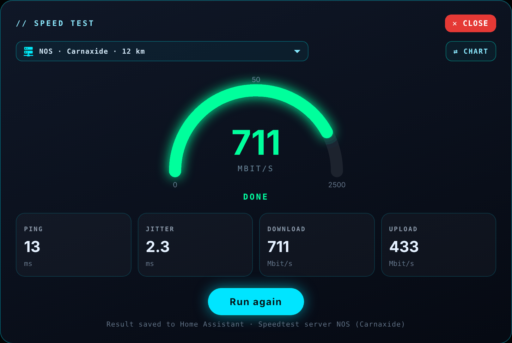
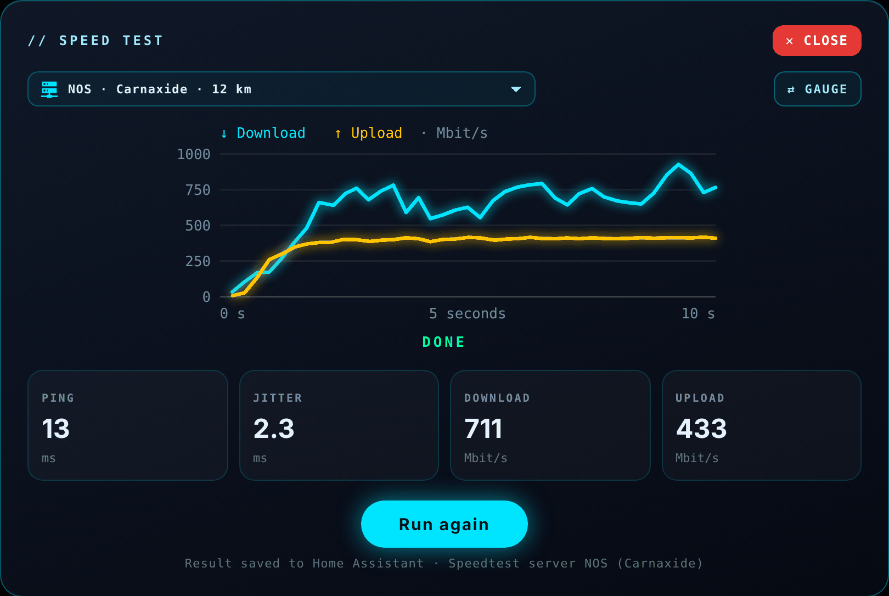

# Speedtest Popup Card

A Home Assistant dashboard card that runs an internet speed test in a popup: ping, jitter, download and upload, with a live gauge. The test runs in the browser of the device you are looking at the dashboard on, so it measures that device's connection, not the Home Assistant server's.

[Versão em português](README.pt-PT.md)



The card itself is a single button. It shows the last result on the right:


## What it does

- Opens a popup on top of the dashboard and runs the test when you press **Start test**. A test takes about 25 seconds.
- Measures ping and jitter first, then download, then upload. The gauge follows the speed in real time, and you can set the top of its scale with `max`.
- Can store the result in Home Assistant helpers, so you can chart it, use it in automations or show it on other cards. This is optional.
- Without helpers, it remembers the last result in the browser.
- Optional chart: with `chart: true`, a button in the popup swaps the gauge for the download and upload curves, second by second.
- English and Portuguese. It follows the language of your Home Assistant profile.
- No other cards or integrations are needed.

## What's new in 1.1.0

- **Chart panel.** A new optional panel shows the download and upload curves over time. A button in the popup swaps between the gauge and the chart. Turn it on with `chart: true`.
- **Ready for multi-gigabit lines.** The download now uses 8 connections with blocks that grow from 5 up to 50 MB when the line can take it, and the upload uses 6 connections with blocks up to 32 MB. The fixed 5 MB blocks of 1.0.0 could not fill a 2 Gbit/s line.
- **Adjustable gauge scale.** The gauge used to stop at 1000 Mbit/s. The new `max` option sets the top of the scale, for example `max: 2500`.

Nothing changes for existing cards: without the new options the card looks and behaves as before. The full history is in [CHANGELOG.md](CHANGELOG.md).

## The chart panel

Add `chart: true` to the card and a **Chart** button appears at the top of the popup, next to **Close**:



- The button swaps the gauge for the chart and back. You can press it before, during or after a test.
- The blue line is the download speed and the yellow line is the upload speed, both in Mbit/s.
- The horizontal axis is the time since the start of each phase, in seconds. Both lines start at zero, so you can compare how fast each one ramps up and how steady it stays.
- The vertical scale adjusts itself to the highest speed measured, so it needs no configuration on slow or very fast lines.
- The lines are drawn live while the test runs and stay on screen when it ends, until you run another test or reload the page.
- The popup always opens on the gauge.

A dip in the middle of a line usually means the connection was shared with something else at that moment, or that the Wi-Fi signal dropped. A line that climbs slowly and never flattens suggests the test is too short for that connection: try a higher `duration`.

## How the measurement works

The card talks to Cloudflare's public speed test endpoints (`speed.cloudflare.com`) directly from your browser:

| Value | How it is measured |
| --- | --- |
| Ping | The fastest of 16 small requests |
| Jitter | The median difference between consecutive requests |
| Download | 8 parallel connections fetching 5 to 50 MB blocks for 10 seconds |
| Upload | 6 parallel connections sending 1 to 32 MB blocks for 10 seconds |

Things to know before you rely on the numbers:

- **It measures the device in front of you.** On a wired PC you get the line speed. On a phone you get that phone's Wi-Fi. This is different from the built-in Speedtest.net integration, which runs on the Home Assistant server.
- **Ping is higher than a classic ping.** It is measured with web requests, which add some overhead.
- **A browser test usually reads a little below a native app** on very fast lines.
- **The device needs internet access** and must be able to reach `speed.cloudflare.com`.
- **Cloudflare can limit or change these endpoints.** They are public, but they are not a guaranteed service for third parties. If requests are refused, the card falls back to smaller blocks; if everything is refused, it shows "Test failed" and stores nothing. Running many tests in a row can trigger these limits.
- **Each test uses data:** roughly 1 GB down and 500 MB up on a 1 Gbit/s line with the default duration. Lower `duration` on metered connections.

## Installation

### Home Assistant Marketplace (HACS)

[](https://my.home-assistant.io/redirect/marketplace_repository/?owner=miltonleopoldo&repository=speedtest-popup-card&category=plugin)

Or add it by hand:

1. Go to **Settings → Marketplace** (on older versions, open **HACS**).
2. Choose **Add from link** (in HACS: **⋮ → Custom repositories**, type **Dashboard**).
3. Paste the address of this repository and press **Install**.
4. Refresh the browser with **Ctrl + F5**.

### Manual

1. Download `speedtest-popup-card.js` from this repository.
2. Copy it to the `config/www` folder of your Home Assistant.
3. Go to **Settings → Dashboards → ⋮ → Resources → Add resource**.
4. Enter `/local/speedtest-popup-card.js` and choose **JavaScript module**.
5. Refresh the browser with **Ctrl + F5**.

## Adding the card

Edit your dashboard, choose **Add card → Manual** and paste:

```yaml
type: custom:speedtest-popup-card
```

That is all the card needs. It will keep the last result in the browser.

## Storing results in Home Assistant (optional)

Create up to four **Number** helpers in **Settings → Devices & services → Helpers → Create helper → Number**:

| Helper | Suggested name | Minimum | Maximum | Step | Unit |
| --- | --- | --- | --- | --- | --- |
| Download | Speed test download | 0 | 10000 | 0.1 | Mbit/s |
| Upload | Speed test upload | 0 | 10000 | 0.1 | Mbit/s |
| Ping | Speed test ping | 0 | 5000 | 0.1 | ms |
| Jitter | Speed test jitter | 0 | 5000 | 0.1 | ms |

Then point the card at them:

```yaml
type: custom:speedtest-popup-card
entities:
  download: input_number.speed_test_download
  upload: input_number.speed_test_upload
  ping: input_number.speed_test_ping
  jitter: input_number.speed_test_jitter
```

You can list only the ones you want. The card writes the result to each helper at the end of a successful test, and the button shows the last result from them.

## Options

| Option | Default | Description |
| --- | --- | --- |
| `title` | `Speed test` | Text on the button and at the top of the popup |
| `duration` | `10` | Seconds for the download phase and again for the upload phase (4 to 30) |
| `max` | `1000` | Top of the gauge scale in Mbit/s (100 to 10000). Set it above your line speed, for example `2500` on a 2 Gbit/s line |
| `chart` | `false` | `true` adds a button in the popup that swaps the gauge for a chart of download and upload speed over time |
| `language` | `auto` | `auto` follows your Home Assistant profile; `en` or `pt` forces a language |
| `entities` | none | Helpers that receive the result: `download`, `upload`, `ping`, `jitter` |

Example with every option:

```yaml
type: custom:speedtest-popup-card
title: Internet speed
duration: 8
max: 2500
chart: true
language: en
entities:
  download: input_number.speed_test_download
  upload: input_number.speed_test_upload
  ping: input_number.speed_test_ping
  jitter: input_number.speed_test_jitter
```

## Troubleshooting

| What you see | What to do |
| --- | --- |
| "Custom element doesn't exist: speedtest-popup-card" | The resource is missing or the browser has an old copy. Check **Resources** and press Ctrl + F5 |
| "Test failed: the server refused the download" | Cloudflare is limiting requests from your address. Wait a few minutes and try again |
| The result is not saved in Home Assistant | Check that the helper names under `entities` exist and are spelled exactly as in **Settings → Entities** |
| The speed is much lower than expected | The test measures the device you are using. Try from a wired computer |

## Licence

MIT. See [LICENSE](LICENSE).

This card is not affiliated with Cloudflare, Ookla or Home Assistant.
