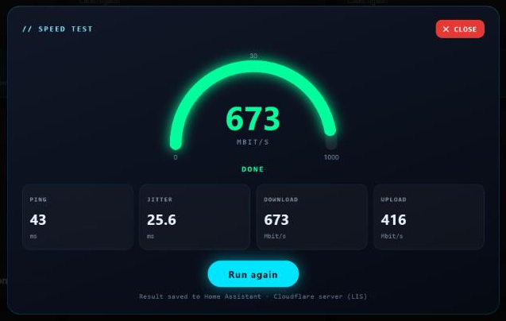
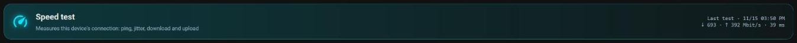

# Speedtest Popup Card

Um cartão para os dashboards do Home Assistant que corre um teste de velocidade à internet numa janela: ping, jitter, download e upload, com um manómetro em tempo real. O teste corre no browser do dispositivo onde estás a ver o dashboard, por isso mede a ligação desse dispositivo e não a do servidor do Home Assistant.

[English version](README.md)



O cartão em si é um botão. À direita mostra o último resultado:



## O que faz

- Abre uma janela por cima do dashboard e corre o teste quando carregas em **Iniciar teste**. Cada teste demora cerca de 25 segundos.
- Mede primeiro o ping e o jitter, depois o download e por fim o upload. O manómetro acompanha a velocidade em tempo real.
- Pode guardar o resultado em ajudantes do Home Assistant, para o pores em gráficos, automações ou outros cartões. É opcional.
- Sem ajudantes, lembra-se do último resultado no próprio browser.
- Português e inglês. Segue a língua do teu perfil no Home Assistant.
- Não precisa de outros cartões nem de integrações.

## Como é feita a medição

O cartão fala diretamente com os endereços públicos de teste de velocidade da Cloudflare (`speed.cloudflare.com`), a partir do teu browser:

| Valor | Como é medido |
| --- | --- |
| Ping | O mais rápido de 16 pedidos pequenos |
| Jitter | A mediana das diferenças entre pedidos seguidos |
| Download | 6 ligações em paralelo a descarregar blocos de 5 MB durante 10 segundos |
| Upload | 4 ligações em paralelo a enviar blocos de 1 a 16 MB durante 10 segundos |

O que convém saber antes de confiar nos números:

- **Mede o dispositivo que tens à frente.** Num PC ligado por cabo, mede a linha. Num telemóvel, mede o Wi-Fi desse telemóvel. É diferente da integração Speedtest.net do Home Assistant, que corre no servidor.
- **O ping sai mais alto do que um ping clássico.** É medido com pedidos web, que têm algum peso extra.
- **Um teste no browser costuma dar um pouco menos do que uma aplicação nativa** em linhas muito rápidas.
- **O dispositivo precisa de internet** e de conseguir chegar a `speed.cloudflare.com`.
- **A Cloudflare pode limitar ou alterar estes endereços.** São públicos, mas não são um serviço garantido para terceiros. Se os pedidos forem recusados, o cartão passa para blocos mais pequenos; se for tudo recusado, mostra "O teste falhou" e não guarda nada. Muitos testes seguidos podem provocar estes limites.
- **Cada teste gasta dados:** cerca de 1 GB de download e 500 MB de upload numa linha de 1 Gbit/s com a duração por omissão. Em ligações com tráfego limitado, baixa a `duration`.

## Instalação

### Marketplace do Home Assistant (HACS)

1. Vai a **Settings → Marketplace** (em versões antigas, abre o **HACS**).
2. Escolhe **Add from link** (no HACS: **⋮ → Custom repositories**, tipo **Dashboard**).
3. Cola o endereço deste repositório e carrega em **Install**.
4. Atualiza o browser com **Ctrl + F5**.

### Manual

1. Descarrega o ficheiro `speedtest-popup-card.js` deste repositório.
2. Copia-o para a pasta `config/www` do teu Home Assistant.
3. Vai a **Settings → Dashboards → ⋮ → Resources → Add resource**.
4. Escreve `/local/speedtest-popup-card.js` e escolhe **JavaScript module**.
5. Atualiza o browser com **Ctrl + F5**.

## Adicionar o cartão

Edita o dashboard, escolhe **Add card → Manual** e cola:

```yaml
type: custom:speedtest-popup-card
```

O cartão não precisa de mais nada. O último resultado fica guardado no browser.

## Guardar os resultados no Home Assistant (opcional)

Cria até quatro ajudantes do tipo **Number** em **Settings → Devices & services → Helpers → Create helper → Number**:

| Ajudante | Nome sugerido | Mínimo | Máximo | Passo | Unidade |
| --- | --- | --- | --- | --- | --- |
| Download | Speed test download | 0 | 10000 | 0,1 | Mbit/s |
| Upload | Speed test upload | 0 | 10000 | 0,1 | Mbit/s |
| Ping | Speed test ping | 0 | 5000 | 0,1 | ms |
| Jitter | Speed test jitter | 0 | 5000 | 0,1 | ms |

Depois indica-os ao cartão:

```yaml
type: custom:speedtest-popup-card
entities:
  download: input_number.speed_test_download
  upload: input_number.speed_test_upload
  ping: input_number.speed_test_ping
  jitter: input_number.speed_test_jitter
```

Podes indicar só os que quiseres. No fim de cada teste bem-sucedido, o cartão escreve o resultado em cada ajudante, e o botão passa a mostrar o último resultado a partir deles.

## Opções

| Opção | Por omissão | Descrição |
| --- | --- | --- |
| `title` | `Teste de velocidade` | Texto do botão e do topo da janela |
| `duration` | `10` | Segundos da fase de download e outros tantos da fase de upload (4 a 30) |
| `language` | `auto` | `auto` segue o teu perfil do Home Assistant; `pt` ou `en` força uma língua |
| `entities` | nenhum | Ajudantes que recebem o resultado: `download`, `upload`, `ping`, `jitter` |

Exemplo com todas as opções:

```yaml
type: custom:speedtest-popup-card
title: Velocidade da internet
duration: 8
language: pt
entities:
  download: input_number.speed_test_download
  upload: input_number.speed_test_upload
  ping: input_number.speed_test_ping
  jitter: input_number.speed_test_jitter
```

## Problemas comuns

| O que aparece | O que fazer |
| --- | --- |
| "Custom element doesn't exist: speedtest-popup-card" | Falta o recurso ou o browser tem uma cópia antiga. Confirma em **Resources** e carrega em Ctrl + F5 |
| "O teste falhou: o servidor recusou o download" | A Cloudflare está a limitar os pedidos do teu endereço. Espera uns minutos e tenta outra vez |
| O resultado não fica guardado no Home Assistant | Confirma que os nomes em `entities` existem e estão escritos tal como em **Settings → Entities** |
| A velocidade é muito mais baixa do que o esperado | O teste mede o dispositivo que estás a usar. Experimenta num computador ligado por cabo |

## Licença

MIT. Ver [LICENSE](LICENSE).

Este cartão não tem ligação à Cloudflare, à Ookla nem ao Home Assistant.
